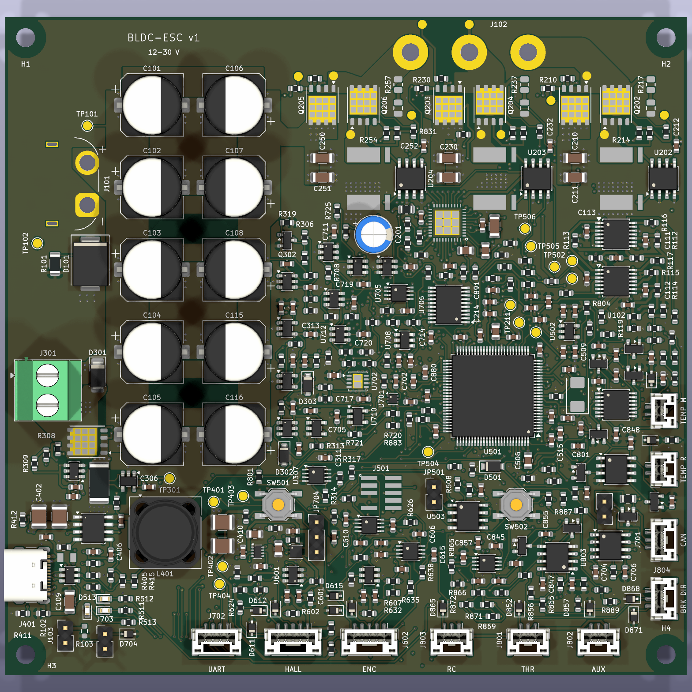

# BLDC ESC

i'm building a small vesc like controller for BLDC and PMSM motors. the first motor is a 26V Groschopp gearmotor, but i want the board to be useful for other motors too. Hall control first, then FOC later

## status

the PCB is fully routed on four copper layers. it's 116 x 112 mm, with 449 component footprints on top and four mounting holes. the fitted BOM has 414 components across 110 different part numbers. KiCad reports zero DRC violations, zero open connections and no schematic mismatches. ERC is clean too

inner logic routing uses a 0.127 mm minimum. some control routes share the inner ground layer, and its filled ground pour stays connected. the USB pair has a continuous ground reference along its bottom-layer path, apart from the via transitions

the mounting holes, fabrication files and first bring-up firmware are done. PCBWay has the board and stencil files for review. the board hasn't been built, powered or tested. the final stack, USB impedance, cooling and some part availability still need checking before ordering

**don't manufacture the devlog 03 snapshot (`dcad1e4`).** the XT60 connections were backwards in that version. the current design has pad 1 as GND and pad 2 as VBUS

devlogs are on [Half Life](https://halflife.hackclub.com/projects/cmuveje4m009201rvgvsn2jbz) and synced to [JOURNAL.md](https://github.com/EwoudVV/bldc-esc/blob/main/JOURNAL.md)

## hardware

- STM32G474VET6 and DRV8353S gate driver
- six 60V bridge MOSFETs and three 1 milliohm current shunts
- INA241 current sensing, voltage sensing and temperature inputs
- hardware current protection, watchdog and brake chopper
- Hall and encoder inputs, analog throttle, RC PWM and digital controls
- CAN FD, UART, USB-C and SWD
- XT60 power input, MT60 motor pigtail and JST-GH signal connectors

## targets

- 12-30V input, mainly for 6S batteries and 24V systems
- 15A RMS phase current with passive cooling, 20A with extra cooling
- around 40A peak, with the allowed duration still to be worked out
- four layers, with 2 oz outer copper and 1 oz inner copper planned; exact stack pending PCBWay review

these current ratings are targets until thermal testing is done

## test motor

Groschopp / Blue-White BL6560-PS2120, P/N 930-23-9002:

- 26V, 0.75A nameplate
- 10W reducer output, 125 RPM, 6.68 in-lb torque
- 20:1 gearbox
- three phase leads and a separate sensor wire bundle

the OEM sensor pinout and motor measurements still need checking

## files

- `bldc-esc.kicad_pro`: open this in KiCad
- `schematic/`: the circuit sheets
- `bldc-esc.kicad_sym` and `bldc-esc.pretty/`: local symbols and footprints
- [bom.csv](bom.csv): component list, including the DNP flags

## mounting and assembly

there are four 3.2 mm non-plated holes for M3 mounting, on a 109 x 105 mm rectangle. each hole has a 7 mm copper keepout on every copper layer. use screw heads no larger than 6.4 mm and check the standoff clearance before fitting the board

the plan is to assemble one board myself at the makerspace with a stencil and reflow equipment. the top-only stencil is 0.10 mm thick and frameless. its paste file leaves out the seven DNP parts and keeps the segmented thermal-pad apertures. this is my first board with this kind of assembly, so i'll get help checking the paste and joints before powering it

## firmware

[firmware/BUILD.md](firmware/BUILD.md) has the build instructions, programming connections and UART commands. the first build can report input states and ADC readings, and read the gate driver's registers. ARM, all six PWM outputs and brake PWM stay low. the gate driver can only wake for register reads when the bus checks pass

the firmware builds for the STM32G474VET6. all three host tests passed, covering commands and measurements, reset outputs and UART input handling. it hasn't been flashed to a board. USB, CAN, motor commutation and FOC are still to come

## parts and fabrication

[the full purchasing BOM](manufacturing/BOM.md) has every part number, fitted and order quantities, vendor links, quotes and availability notes. the [purchasing CSV](manufacturing/purchasing-draft.csv) is the same detailed parts list in spreadsheet form. [BOM.md](BOM.md) is the grouped list synced from Half Life

quotes checked on October 11: five bare PCBWay boards are $311.90, the stencil is $10, and the component merchandise estimate is $191.29 before shipping, tax and discounts. the component figure includes backorders and unconfirmed offers. 100 of the 110 part numbers had confirmed stock; ten still need a source or delivery confirmation

the website list is $543.92 with its current shipping and tariff allowance. that is still an estimate, not a final checkout total. the full BOM explains the discounts, missing shipping quotes and difference from the supplier carts. nothing has been paid for. submission is paused while the over-budget form issue is sorted out

before ordering, PCBWay needs to confirm the 2 oz outer / 1 oz inner copper stack, layer-specific routing limits, small vias and 90 ohm USB pair. the quote form forces 8 mil globally even though the inner routing is 0.127 mm. the uploaded notes give the actual geometry, and a price and impedance review is pending

## manufacturing files

- [PCBWay package](manufacturing/pcbway-fabrication.zip): Gerbers, drills, top paste and order notes
- [Gerbers](manufacturing/bldc-esc-gerbers.zip): copper, mask, silkscreen, outline and drills
- [stencil package](manufacturing/stencil/bldc-esc-stencil.zip): top paste with the DNP apertures removed
- [schematic PDF](manufacturing/schematic.pdf): exported drawings for review
- [fitted parts](manufacturing/parts-one-board.csv): quantities for one assembled board
- [order settings](manufacturing/order-settings.json): stack, routing, mounting and quote details
- [design checks](manufacturing/design-checks.json): saved board checks
